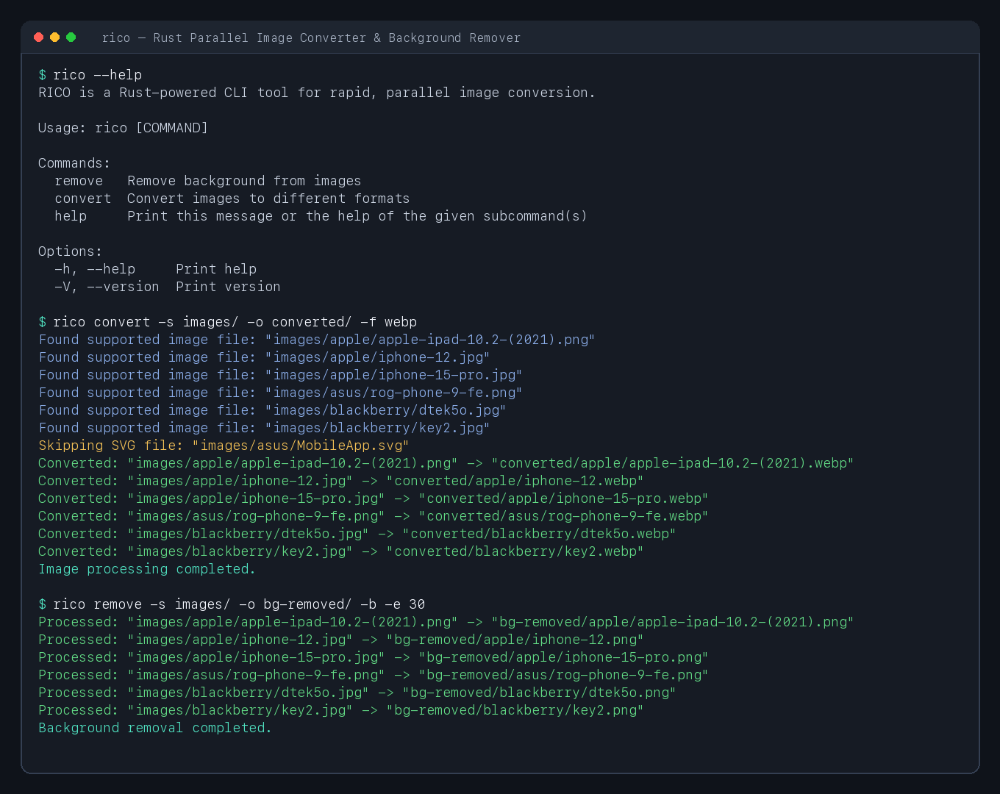
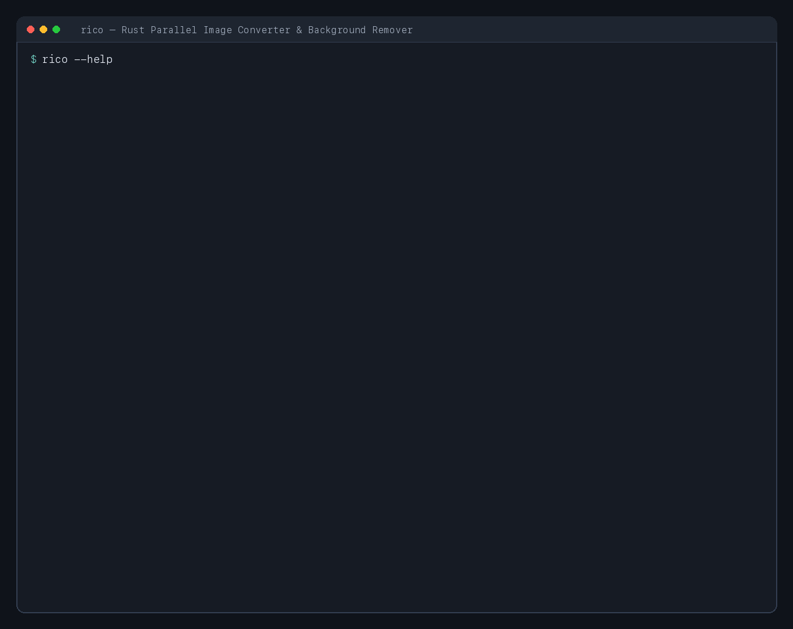
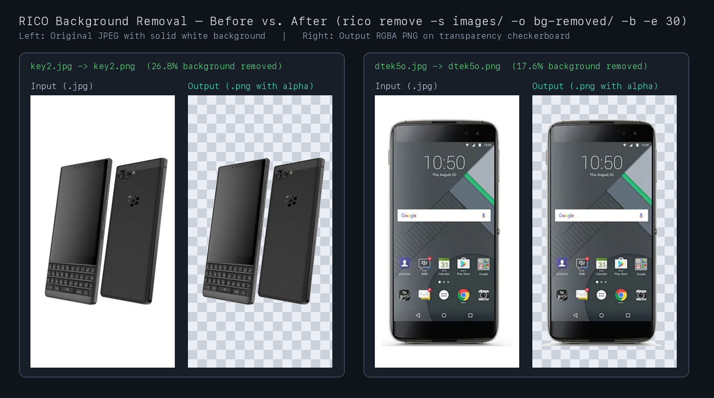

# rico

RICO (**R**ust **I**mage **Co**nverter) is a fast, Rust-powered CLI tool for bulk parallel image format conversion and automated background removal.

Built on [Rayon](https://github.com/rayon-rs/rayon) for multi-core data parallelism and the [`image`](https://github.com/image-rs/image) crate for native decoding and encoding, `rico` processes entire directory trees of product or asset imagery in seconds while preserving relative folder hierarchies.



## Why RICO?

Managing large image catalogs—such as e-commerce product libraries or CDN media directories—typically requires converting thousands of legacy PNG/JPEG assets into modern formats like WebP and stripping solid white studio backgrounds into transparent PNGs. Sequential shell scripts and single-threaded tools bottleneck on CPU-bound decoding and encoding.

`rico` solves this by:

- **Parallelizing across all CPU cores**: Recursively discovers images via `walkdir` and processes them concurrently across a Rayon thread pool.
- **Preserving directory hierarchies**: Mirrors nested source subdirectories automatically in the target output directory (or converts in-place).
- **Content-aware format detection**: Inspects file magic bytes rather than trusting file extensions alone, gracefully skipping non-image files and unsupported vector formats like SVG.
- **Zero external native runtime dependencies**: Compiles to a single standalone binary without requiring ImageMagick or FFmpeg on the host system.

## Performance

On an Apple M1 Max MacBook Pro across a dataset of **5,740 product images**:

- **Bulk Format Conversion to WebP**: ~1 second for 5,740 images.
- **Parallel Background Removal**: under 5 seconds for 5,740 images.

## Key Features

- **Bulk Format Conversion (`rico convert`)**: Convert images between `PNG`, `JPEG`, `BMP`, and `WEBP`.
- **Edge-Aware Background Removal (`rico remove`)**: Strips outer near-white backgrounds to transparent RGBA PNGs using border-seeded Breadth-First Search (BFS) flood-fill with configurable RGB edge-threshold stopping.
- **Recursive Directory Traversal**: Processes nested subdirectories automatically and creates missing output directories on demand.
- **Safe Idempotent Execution**: Skips unsupported files (such as `.svg`) and avoids overwriting existing target files during format conversion.

## Visual Demonstrations

### Animated CLI Session



### Background Removal (Before vs. After)

`rico remove -b` seeds a flood-fill queue from the outer border pixels and removes contiguous near-white background regions (`R, G, B > 240`), halting cleanly when the per-channel color difference against neighboring pixels exceeds `--edge-threshold` (default: `30`).



## Installation

### Quick Install

Install `rico` system-wide to `/usr/local/bin` using the installation script:

```sh
curl -fsSL https://raw.githubusercontent.com/ranajahanzaib/rico/main/install_rico.sh | sudo bash
```

This script verifies your Rust toolchain, clones the repository, builds the optimized release binary via Cargo, and installs `rico` into `/usr/local/bin`.

### Build from Source

Requires the [Rust toolchain](https://www.rust-lang.org/) (`cargo` and `rustc`).

#### 1. Clone the Repository

```sh
git clone https://github.com/ranajahanzaib/rico.git
cd rico
```

#### 2. Build the Release Binary

```sh
cargo build --release
```

The compiled binary will be output to `target/release/rico`.

#### 3. Install to Your `PATH` (Optional)

```sh
sudo mv target/release/rico /usr/local/bin/
```

#### 4. Verify Installation

```sh
rico --version
```

## Usage

`rico` provides two primary subcommands: `convert` and `remove`.

```text
RICO is a Rust-powered CLI tool for rapid, parallel image conversion.

Usage: rico [COMMAND]

Commands:
  remove   Remove background from images
  convert  Convert images to different formats
  help     Print this message or the help of the given subcommand(s)

Options:
  -h, --help     Print help
  -V, --version  Print version
```

### 1. Converting Images to a Different Format (`rico convert`)

Convert all supported images in a source directory (and its subdirectories) to a target format:

```sh
rico convert -s images/ -o converted/ -f webp
```

#### Options for `convert`

| Option | Long Flag           | Description                                         | Default               |
| :----- | :------------------ | :-------------------------------------------------- | :-------------------- |
| `-s`   | `--source <source>` | Source directory for input images (**required**)    | —                     |
| `-o`   | `--output <output>` | Output directory for converted images               | `<source>` (in-place) |
| `-f`   | `--format <format>` | Target format (`png`, `jpg`, `jpeg`, `bmp`, `webp`) | `png`                 |

#### Examples

Convert all images in `images/` to WebP and save them in `converted/`:

```sh
rico convert -s images/ -o converted/ -f webp
```

Convert all images in `images/` to JPEG:

```sh
rico convert -s images/ -o converted/ -f jpg
```

Convert images in-place (writes converted files alongside originals in `images/`):

```sh
rico convert -s images/ -f webp
```

### 2. Removing Backgrounds from Images (`rico remove`)

Remove outer near-white backgrounds from images and output transparent RGBA PNGs:

```sh
rico remove -s images/ -o processed/ --background
```

#### Options for `remove`

| Option | Long Flag                  | Description                                      | Default               |
| :----- | :------------------------- | :----------------------------------------------- | :-------------------- |
| `-s`   | `--source <source>`        | Source directory for input images (**required**) | —                     |
| `-o`   | `--output <output>`        | Output directory for processed PNG images        | `<source>` (in-place) |
| `-b`   | `--background`             | Enable background removal                        | —                     |
| `-e`   | `--edge-threshold <value>` | Edge detection sensitivity threshold (`0`–`255`) | `30`                  |

#### Examples

Remove backgrounds from all images in `images/` and save transparent PNGs to `processed/`:

```sh
rico remove -s images/ -o processed/ -b
```

Remove backgrounds with a custom edge detection threshold (`40`):

```sh
rico remove -s images/ -o processed/ -b -e 40
```

## Supported Formats

| Capability                     | Formats                                     | Notes                                                 |
| :----------------------------- | :------------------------------------------ | :---------------------------------------------------- |
| **Input Formats (`convert`)**  | `PNG`, `JPEG`, `BMP`, `WEBP`                | Detected via file content magic bytes                 |
| **Output Formats (`convert`)** | `PNG`, `JPEG`, `BMP`, `WEBP`                | Preserves relative directory structure and file stems |
| **Input Formats (`remove`)**   | `PNG`, `JPEG`, `BMP`, `WEBP`, `GIF`, `TIFF` | Decoded using content-guessed format                  |
| **Output Format (`remove`)**   | `PNG` (8-bit RGBA)                          | Transparent alpha channel (`Rgba([0, 0, 0, 0])`)      |

Unsupported formats (such as `.svg`) are automatically skipped.

## Architecture & Technical Overview

- **CLI Parsing**: Built with `clap` v4 defining the `convert` and `remove` subcommands and validated arguments.
- **Directory Discovery**: Uses `walkdir::WalkDir` to recursively traverse nested source directories.
- **Data Parallelism**: Dispatches per-file conversion and background removal across Rayon's work-stealing thread pool (`par_iter()`).
- **Background Removal Algorithm**: Converts decoded images to `Rgba8`, seeds a `VecDeque` BFS queue with all perimeter pixels (top, bottom, left, and right borders), and flood-fills inward across near-white pixels (`R > 240 && G > 240 && B > 240`). At each pixel, 4-connected neighbors are checked with `is_edge()` (`|R1 - R2| > threshold || |G1 - G2| > threshold || |B1 - B2| > threshold`) so flood-filling stops at object boundaries and never erases white regions enclosed inside the subject.

## Testing

Run the unit test suite with Cargo:

```sh
cargo test
```

## Contributing

Contributions are welcome! Feel free to submit pull requests or open issues:

- Follow Rust's standard style conventions (`cargo fmt` and `cargo clippy`).
- Write tests for bug fixes and new functionality.
- Optimize for multi-core throughput and low memory overhead.

## License

This project is licensed under the MIT License. See [LICENSE](./LICENSE) for details.
